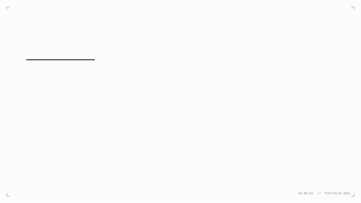

# Suman Mandal — Portfolio

**Java Backend Developer** · Java 21 · Spring Boot 3.5 · Docker · Kubernetes

---

## Showcase

<p align="center">
  <a href="https://github.com/RajsProjects/Portfolio_website/releases/download/showcase-v1/portfolio_showcase.mp4">
    
  </a>
</p>

<p align="center">
  <a href="https://github.com/RajsProjects/Portfolio_website/releases/download/showcase-v1/portfolio_showcase.mp4">
    <strong>Watch / Download Full-HD Video (1080p &middot; 60 fps &middot; MP4 with Audio) &#x2197;</strong>
  </a>
</p>

---

## Design & Technical Stack

- **Aesthetic**: Minimal monochrome (`#ffffff` canvas, `#000000` headings), watercolor hero portrait, and an architectural SVG system diagram.
- **Typography**: Self-hosted [`Departure Mono`](assets/fonts/DepartureMono-Regular.woff2).
- **Motion & Stack**: Hand-written semantic HTML (`index.html`), vanilla CSS (`style.css`), and lightweight scroll/entrance choreography with `anime.min.js` (`main.js`).

## Featured Backend Highlight

- **[Society Management System](https://github.com/RajsProjects/society-management)** — Multi-module REST API with Java 21, Spring Boot 3.5, stateless JWT + RBAC (`ADMIN` / `RESIDENT`), MongoDB Atlas compound indexes, Redis response caching, 78 JUnit 5 & Mockito unit tests, Kubernetes HPA orchestration, Prometheus + Grafana observability, and k6 load validation (`17,922` requests across `200` concurrent virtual users with `0%` error rate).

## Local Preview

```bash
python -m http.server 8080
```

Then open `http://localhost:8080`.

## Connect

- **GitHub**: [github.com/RajsProjects](https://github.com/RajsProjects)
- **LinkedIn**: [linkedin.com/in/suman-mandal-63b42a316](https://www.linkedin.com/in/suman-mandal-63b42a316/)
- **LeetCode**: [leetcode.com/u/Rajmandal5214](https://leetcode.com/u/Rajmandal5214/)
- **Email**: [sumanmandal8955@gmail.com](mailto:sumanmandal8955@gmail.com)
